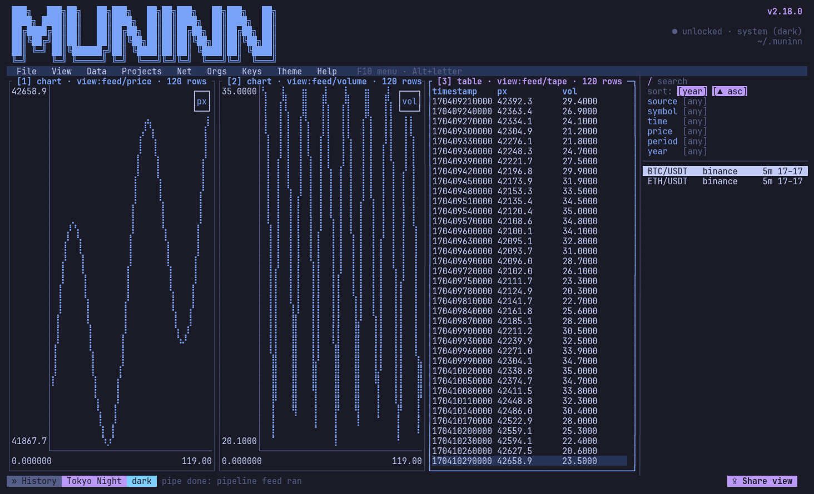
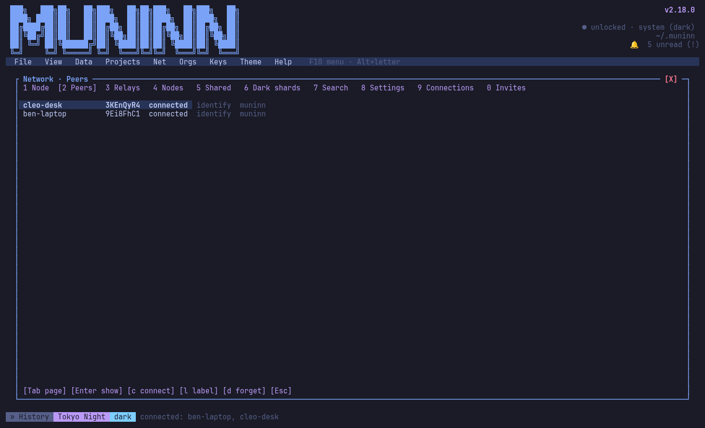
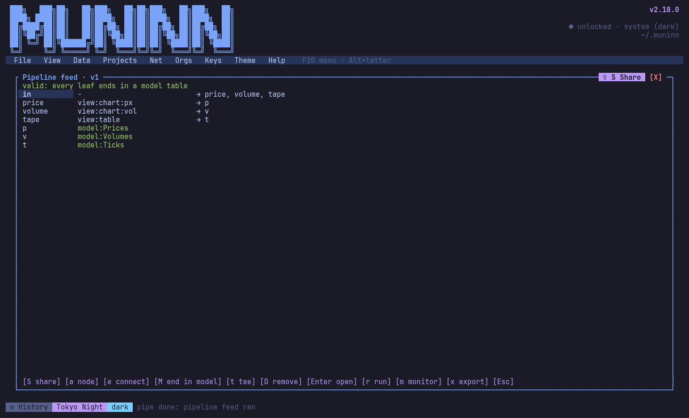
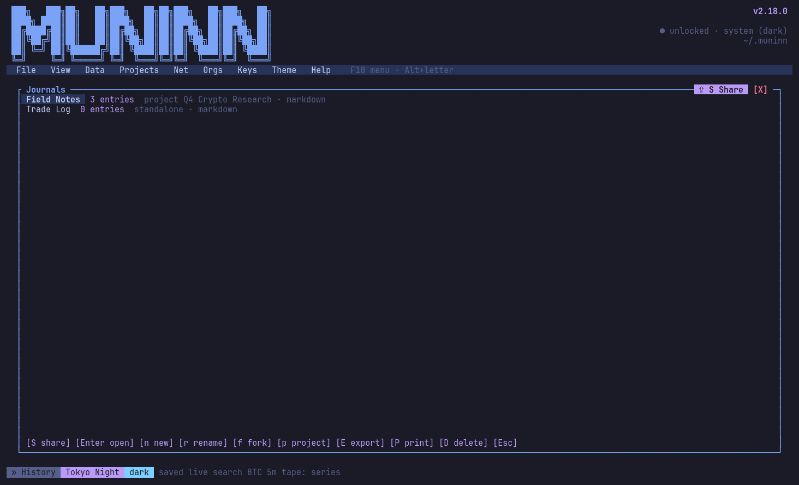
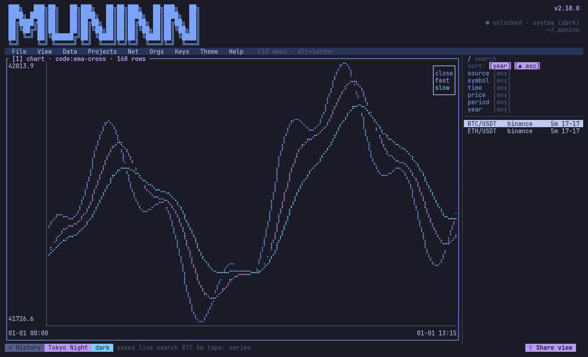
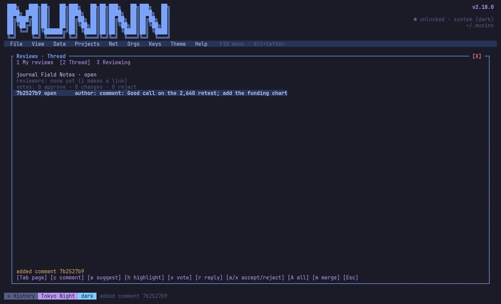
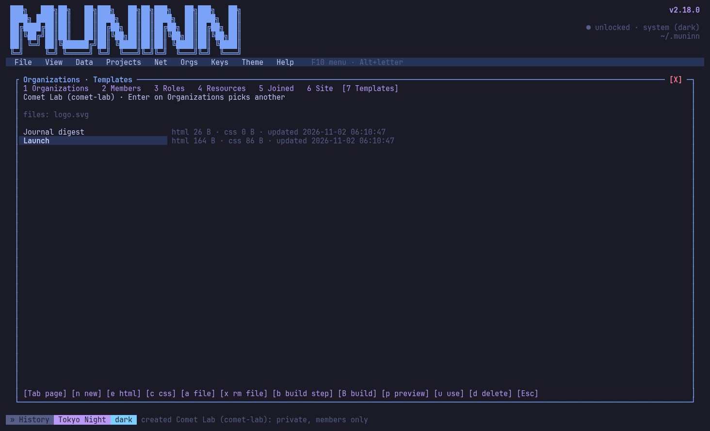
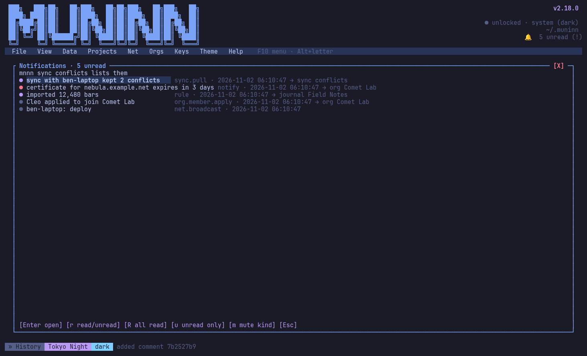

# Muninn 2.0: decentralized data workflows



Muninn (`mnnn`) is a local, encrypted workbench for market data, with a terminal UI and a
CLI. 2.0 turns it into a network: your data moves through pipelines you can read and edit,
and between nodes you own, your connections and your organizations, peer to peer, with
no central server holding it. It was released as
v2.0.0 through v2.20.0. The core from 1.x (ingest, encryption, backups, export, charts,
tiling and themes) is in the [Muninn 1.0 announcement](https://github.com/WeirdBrains/muninn/blob/main/docs/historical/1.0/ANNOUNCEMENT.md).

## Data that flows between nodes you own

- **Peer to peer**: every node runs over TCP and QUIC with Noise encryption (libp2p), with local discovery, relays and hole punching. Key exchanges happen automatically when you connect, and nothing goes through a server you don't run.
- **Live collaboration**: message peers (`mnnn msg send`), edit the same entry, journal, code space or record at once and see each other's cursors (`mnnn live share`), and run each other's served executables (`mnnn peers run`). Sessions run over gRPC bidirectional streams; where a stream can't be reached, such as a container that publishes no port, nodes fall back to polling over the peer connection, automatically or with `--transport poll`.
- **Peers**: `mnnn peers` shows who you're connected to; `mnnn peers show ben` lists what a peer has for you: shared items, live sessions, executables and sites.
- **Share anything, anywhere**: send any item to a project, journal, code space or connection, or onto the network, and review it with comments, suggestions, highlights and votes on the reviewer's own node.
- **Users, linked nodes and sync**: one identity across your nodes, all your data on all of them, end to end encrypted.
- **Organizations**: roles, members and hosted HTTPS sites (HTML, JSON and gRPC) with your own domains and Let's Encrypt certificates that renew themselves.
- **Relays**: nodes behind NAT reach each other through relays, and any node can offer to be one.
- **Dark shards**: your master key split among trusted peers, sealed so they cannot read it.



## The pipeline: your parsers, your shapes

Muninn doesn't decide what incoming data looks like. Sources hand on what they have, and
every shape after that is made by code you can open and change.

- **Raw in, code out**: standard input arrives raw, one `text` column, nothing parsed. Parsing is a step: `parse-csv`, `parse-json`, `parse-ndjson` and `to-bars` ship as editable code spaces (`mnnn code parsers --install`), and `mnnn code create mine --from parse-csv` starts your own.
- **Pipes**: `cat trades.csv | mnnn pipe - --format csv code:fast --to model:trades`. `--format csv|json|ndjson` just puts the matching parser in front as a visible step, and `--chunk N` keeps endless input like `tail -f` flowing.
- **Pipelines**: saved graphs with fan-out and fan-in that end in model tables (`mnnn pipeline create|run`), designed node by node in the Pipeline Designer and watched live in tiles. Every hop is recorded with its rows, time and errors.
- **Pipelines travel too**: export and import them with their code and models, or share them over the network, where they arrive as drafts that run only once approved.



## Your data for AI assistants, on your terms

- **MCP server**: `mnnn mcp serve` (stdio, or HTTP on 127.0.0.1:4743) exposes journals, projects, models and records, reports, live searches, code-space results and org executables to MCP clients. Each client is named, revocable and has a role (read by default; write, run or full), and writes and runs land in history.
- **Built-in HTTPS**: `mnnn mcp serve --tls-domain mcp.example.com --tls-email you@example.com` gets a Let's Encrypt certificate and renews it while it runs; no proxy needed (an nginx and certbot setup is documented too).
- **MCP client**: rule sets call external MCP servers' tools (`then mcp SERVER TOOL k=v`) and read them in conditions, each tool approved before its first call.

## Research, kept together

- **Authors and action history**: every import, export and change is saved with who did it; step back, forward and fork.
- **Live searches, projects and journals**: saved questions that rerun on new data, grouped with their results and Markdown or LaTeX notes.
- **Reports**: sections built from records, journals and projects, exported to HTML, PDF, Word, LaTeX, JSON or CSV.



## Rules, models and code

- **Rule sets**: when something happens, or on a schedule (`--every 6h`, `--cron`), run searches, exports, entries or notes.
- **Model Designer and templates**: design record tables, migrate them with previews and roll back; export, import and share designs.
- **Code spaces**: math, Polars, Rust or Python over your data, compiled to native plugins. Python is parsed and translated in Rust, no libpython needed.


## Organizations and their sites



- **Org site templates in the app**: edit a site's HTML and CSS in the TUI (Orgs ▸ Templates) or in `$EDITOR`, manage its files, preview it live through the local site, and add build steps for React, Jaspr and other compiled templates. Build steps run in a scratch copy, and each node asks before running a new or changed command. A starting or stopping site tells the org's nodes, your linked nodes and connections where it is.



## Notifications and broadcasts

- **Notifications**: exchange requests, org applications, review comments and votes, sync conflicts, code waiting for approval and certificate warnings all notify you. A bell in the TUI header shows the unread count. `!` opens the list, and `Enter` takes you to the review, org, journal or project a notification is about. From the shell, use `mnnn notify list`. You can mute any kind.
- **Rule sets notify, and react to notifications**: `then notify "imported {inserted} bars" level=warn`, or `--on notification --if "level = error"`.
- **Node broadcasts**: `mnnn net broadcast deploy "v2 is out" --to connections` (or your linked nodes, or an org's nodes) sends a short message over the same trusted key exchanges as everything else. It arrives as a notification and as a trigger that rule sets can act on, and rule sets can send broadcasts too.



- **Clickable hints**: every key shown in a hint is also a button you can click.

## Install

Every package ships a prebuilt `mnnn` binary; no Rust is needed. Downloads and
`SHA256SUMS` are on the [v2.20.1 release](https://github.com/WeirdBrains/muninn/releases/tag/v2.20.1)
(full steps in [install](install.md)).

| Platform | Download | Install |
|----------|----------|---------|
| Linux or macOS (tarball) | `muninn-2.20.1-<target>.tar.gz` for `x86_64`/`aarch64-unknown-linux-gnu` and `x86_64`/`aarch64-apple-darwin` | `tar -xzf …` then `install -Dm755 muninn-2.20.1-<target>/mnnn ~/.local/bin/mnnn` |
| Debian / Ubuntu | `muninn_2.20.1-1_amd64.deb`, `muninn_2.20.1-1_arm64.deb` | `sudo apt install ./muninn_2.20.1-1_amd64.deb` |
| Fedora | `muninn-2.20.1-1.x86_64.rpm`, `muninn-2.20.1-1.aarch64.rpm` | `sudo dnf install ./muninn-2.20.1-1.x86_64.rpm` |
| Arch Linux | `muninn-bin-2.20.1-1-x86_64.pkg.tar.zst`, `…-aarch64.pkg.tar.zst` | `sudo pacman -U muninn-bin-2.20.1-1-x86_64.pkg.tar.zst` |
| Homebrew | tap `weirdbrains/tap` | `brew install weirdbrains/tap/muninn` (or `--cask` for Muninn.app) |
| Windows (x64, arm64) | `muninn-2.20.1-x86_64-windows-setup.exe`, `…-aarch64-windows-setup.exe` (and portable zips) | run the setup.exe, or `winget install WeirdBrains.Muninn` |
| macOS app | `muninn-2.20.1-macos.dmg` | open it and drag Muninn to Applications |

Then try it somewhere disposable:

```sh
export MUNINN_HOME=/tmp/muninn-demo
mnnn keys init        # a password, then 24 words to keep offline
mnnn                  # the TUI; ? opens the help
```

Your data stays in `~/.muninn` (or `MUNINN_HOME`); installing or uninstalling never
touches it. Thanks for trying Muninn: tell us what you build with it on
[GitHub](https://github.com/WeirdBrains/muninn).
